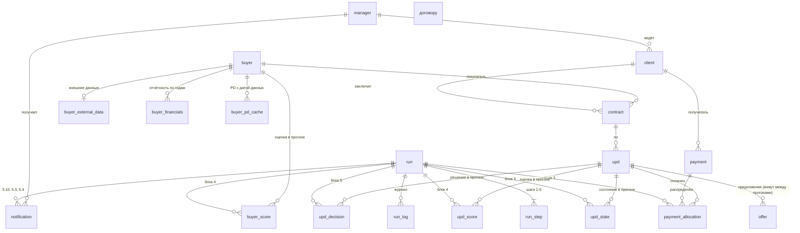

# Модуль 0.1. Модель данных

Все таблицы — в одной схеме `${schema}` (`POSTGRES_SCHEMA`, на стенде и в тестах — `smart_factoring_test`).
Схема создаётся на стенде заранее, приложение её не создаёт. Две группы таблиц:

- **`demo_*`** — имитации источников и получателей (ДД-1). Сюда импортируются выгрузка генератора и `events.csv`.
  Блок 1 читает отсюда через адаптеры, имитации получателей пишут сюда. Замена на реальную интеграцию
  убирает таблицы `demo_*`, но не меняет основные.
- **основные** — загруженные данные и результаты прогонов.

Соглашения: ключи `bigint generated always as identity`; деньги `numeric(19,2)`; вероятности, ставки, доли
`numeric(9,6)`; коэффициенты отчётности `numeric(19,6)`; даты `date`; моменты `timestamptz`;
перечисления `varchar(32)` + `check`; гибкие наборы чисел (метрики шага, параметры, причины) — `jsonb`.

## ER-диаграмма основной схемы

---

## Таблицы `demo_*`

### Источники (выгрузка генератора)

**`demo_import_batch`** — факт импорта.
`id`, `kind` (`GENERATOR` / `EFRSB`), `format_version`, `seed`, `data_date` (последняя дата УПД/платежа),
`snapshot_date` (дата снимка внешних данных), `source_name`, `row_counts jsonb`, `imported_at`.

**`demo_manager`** — `id`, `code` uk, `full_name`.

**`demo_client`** — клиенты банка (синтетика).
`id`, `inn` uk, `name`, `industry` (`CONSTRUCTION` / `PROFESSIONAL` / `MANUFACTURING` / `TRADE`), `okved_section`,
`region`, `abs_liquidity numeric(19,6)` (для TR), `ar_turnover_days int`, `is_core bool` (группа «ядро», ДД-5),
`manager_code`, `edo_consent bool`, `factoring_client bool` (сноска к п. 1.1: такие не загружаются),
`control_case varchar` (К-N, необязательно).

**`demo_buyer`** — реестр покупателей (реальные компании).
`id`, `inn` uk, `ogrn`, `name`, `okved`, `okved_section`, `region`, `registration_date`, `data_date`.
ИНН из УПД, которого нет здесь, — «нет данных по покупателю» (п. 1.4, К-17).

**`demo_buyer_financials`** — отчётность ГИР БО по годам; колонки = строки форм.
`inn`, `year`, uk(`inn`, `year`); `simplified bool`;
баланс: `assets_total` (1600), `current_assets` (1200), `receivables` (1230), `cash` (1250), `equity` (1300),
`long_term_borrowings` (1410), `short_term_liabilities` (1500), `short_term_borrowings` (1510), `payables` (1520);
ОФР: `revenue` (2110), `cost_of_sales` (2120), `sales_profit` (2200), `interest_payable` (2330), `net_profit` (2400).
Это минимальный набор для драйверов 1–22 п. 4.2. Если коллега отдаст больше строк — добавим колонки.

**`demo_contract`** — `id`, `client_inn`, `buyer_inn`, `number`, `contract_date`, `deferral_days int`;
uk(`client_inn`, `number`).

**`demo_upd`** — `id`, `client_inn`, `buyer_inn`, `contract_number`, `number`, `upd_date` (дата отгрузки = подписания),
`amount`, `control_case`; uk(`number`, `upd_date`, `client_inn`) — ключ из НФР-3.

**`demo_payment`** — поступления из выписок клиентов.
`id`, `source_id` uk, `client_inn` (получатель), `payer_inn`, `amount`, `payment_date`, `purpose` (назначение, текст),
`control_case`.

### Внешние данные из `events.csv` (ЕГРЮЛ, ЕФРСБ)

Файл событийный: одна строка = одно событие, статус ЕГРЮЛ и данные дела повторяются в каждой строке.
При импорте раскладываем на три таблицы.

**`demo_egrul_status`** — `inn` pk, `ogrn`, `name`, `region`, `debtor_category`, `status`, `status_date`.

**`demo_bankruptcy_case`** — `id`, `inn`, `case_number`, `court`, `applicant`, `stage` («Статус дела»),
`start_date`, `start_date_source`, `observation_from`, `rehabilitation_from`, `external_management_from`,
`declared_bankrupt_on`, `receivership_from`, `end_date`, `outcome`, `first_intent_date`; uk(`inn`, `case_number`).

**`demo_efrsb_event`** — `id`, `inn`, `case_number`, `event_type`, `event`, `details`, `event_date`, `published_on`,
`message_number` uk, `annulled bool`, `url`.

### Получатели (имитации)

**`demo_factoring_package`** — «ВТБ Факторинг» (п. 6.2). `id`, `offer_id` uk, `payload jsonb`, `received_at`.

**`demo_risk_signal`** — «риск-подразделение» (п. 3.10 в). `id`, `run_id`, `buyer_inn`, `upd_ids jsonb`, `payload jsonb`,
`received_at`; uk(`run_id`, `buyer_inn`).

«Закрытие кассового разрыва» (3.10 б) — только запись в журнал, своей таблицы нет.

---

## Основные таблицы — загруженные данные (блок 1)

Ссылки — по суррогатным ключам основной схемы. Повторная загрузка обновляет (upsert), не дублирует.

| Таблица | Колонки | Ключ уникальности |
|---|---|---|
| `manager` | `id`, `code`, `full_name` | `code` |
| `client` | как в `demo_client` + `manager_id` fk, `loaded_at` | `inn` |
| `buyer` | `id`, `inn`, `ogrn`, `name`, `okved`, `okved_section`, `region`, `registration_date`, `loaded_at` | `inn` |
| `buyer_external_data` | `buyer_id` pk/fk; `egrul_status`, `egrul_status_date`; `bankruptcy_case_number`, `bankruptcy_stage`, `bankruptcy_start_date`, `bankruptcy_end_date`; `data_date` — дата данных (п. 1.3); `loaded_at` | `buyer_id` |
| `buyer_financials` | как в `demo_buyer_financials` + `buyer_id` fk, `data_date` | `buyer_id, year` |
| `contract` | `id`, `client_id`, `buyer_id` (null — покупателя нет в реестре), `buyer_inn`, `number`, `contract_date`, `deferral_days` | `client_id, number` |
| `upd` | `id`, `client_id`, `buyer_id` (null — покупателя нет в реестре, п. 1.4), `buyer_inn`, `contract_id`, `number`, `upd_date`, `amount`, `first_loaded_run_id` | `number, upd_date, client_id` |
| `payment` | `id`, `source_id`, `client_id`, `payer_inn`, `buyer_id` (null, если плательщик не покупатель клиента), `amount`, `payment_date`, `purpose`, `first_loaded_run_id` | `source_id` |

Для покупателя с несколькими делами в `buyer_external_data` попадает «худшее» действующее дело (без даты окончания);
при отсутствии таких — последнее по дате начала. Все события остаются в `demo_efrsb_event` для детализации.

Стоп-фактор (п. 4.1) считается в блоке 4, на дату снимка, по правилу:
- статус ЕГРЮЛ означает банкротство (наблюдение, внешнее управление, конкурсное производство, возбуждено производство),
  ликвидацию (в т. ч. «Ликвидировано…») или исключение (решение о предстоящем исключении, прекращено в связи с исключением);
- **или** есть дело в стадии «Наблюдение», «Финансовое оздоровление», «Внешнее управление», «Конкурсное производство»
  без даты окончания.

«Производство по делу прекращено / завершено» и реорганизация стоп-фактором не являются.
Точное соответствие значений статусов — справочник в коде блока 4, проверяется тестом на фактических значениях файла.

---

## Основные таблицы — прогон (результаты по прогонам, Р-23)

### `run` — прогон

| Колонка | Тип | Смысл |
|---|---|---|
| `id` | bigint | номер прогона (НФР-6) |
| `status` | `RUNNING` / `DONE` / `DONE_WITH_WARNINGS` / `STOPPED` | ПР-6 |
| `calc_date` | date | дата расчёта (ПР-9) |
| `client_ids` | jsonb, null = все | набор клиентов (ПР-2) |
| `initiator_type` | `OPERATOR` / `API` | НФР-7 |
| `initiator` | varchar | логин из JWT |
| `started_at`, `finished_at` | timestamptz | |
| `data_date` | date | последняя дата данных на момент прогона |
| `snapshot_date` | date | дата снимка внешних данных (ДД-6) |
| `parameters` | jsonb | снимок таблицы `parameter` (Р-9, НФР-5) |
| `model_versions` | jsonb | версии PD, задержки, LLM |
| `summary` | jsonb | итоги для истории (ЭП-8): клиентов, УПД, предложений, сумма, доход |
| `error_message` | text | причина остановки |

Индекс «один прогон за раз»: `create unique index ux_run_single_running on run ((true)) where status = 'RUNNING'`.

### `run_step` — шаги

pk(`run_id`, `step_no` 1..5), `status` (`PENDING` / `RUNNING` / `DONE` / `WARNING` / `STOPPED`), `started_at`, `finished_at`,
`metrics jsonb` — числа ЭП-3 (набор свой для каждого шага).

### `run_log` — журнал (ЭП-6, НФР-7)

`id`, `run_id` (null — событие вне прогона, например решение менеджера), `logged_at`, `level` (`INFO` / `WARN` / `ERROR`),
`step_no`, `event_code`, `client_id`, `buyer_id`, `upd_id`, `offer_id`, `message`, `details jsonb`.
Индексы: (`run_id`, `logged_at`), (`upd_id`).

### `payment_allocation` — блок 2

`id`, `run_id`, `payment_id`, `upd_id` (null — нераспределено, п. 2.6), `amount`,
`rule` (`UPD_NUMBER` 2.1 / `CONTRACT_FIFO` 2.2 / `BUYER_FIFO` 2.3 / `CARRY_CONTRACT`, `CARRY_BUYER` 2.4 / `UNALLOCATED` 2.6).

### `upd_state` — блок 3

pk(`run_id`, `upd_id`); `planned_due_date`, `days_to_due int`, `paid_amount`, `outstanding`,
`payment_status` (`UNPAID` / `PARTIAL` / `PAID`), `paid_date` (дата последней оплаты для оплаченных), `delay_days`
(для оплаченных: `paid_date − planned_due_date`), `category smallint 1..8` (null для оплаченных).
История платежей покупателя (п. 3.11) — это строки `payment_status = 'PAID'` + текущие просрочки; отдельной таблицы нет.

### `buyer_score` — блок 4, покупатель

pk(`run_id`, `buyer_id`); `has_external_data bool`, `stop_factor` (null / `BANKRUPTCY` / `LIQUIDATION` / `EXCLUSION`),
`has_payment_history bool`, `pd`, `pd_source` (`MODEL` / `BASE`), `low_data bool`, `risk_level` (`A`..`D`),
`reasons jsonb` (3 причины: признак, значение, направление, вклад), `model_version`, `data_date`, `from_cache bool`.

### `buyer_pd_cache` — PD без пересчёта (п. 4.2)

pk(`buyer_id`, `data_date`, `model_version`); `pd`, `pd_source`, `low_data`, `reasons jsonb`, `calculated_at`.

### `upd_score` — блок 4, УПД

pk(`run_id`, `upd_id`); `status` (`SCORED` / `NO_PAYMENT_HISTORY` / `ERROR`), `delay_threshold_days`, `p_delay`,
`p_overdue_90`, `expected_delay_days numeric(9,2)`, `no_pair_history bool`, `model_version`, `attempts smallint`, `error_message`.
Оцениваются все открытые УПД покупателей без стоп-фактора и с данными — карточка клиента показывает оценку по каждому (п. 5.5).

### `upd_decision` — блок 5

pk(`run_id`, `upd_id`); `category`; `decision` (`OFFER` / `NO_OFFER`); `reason` — код первого сработавшего правила:

| Код | Правило |
|---|---|
| `UPD_PAID` | оплачен полностью (не в реестре открытых) |
| `UPD_OVERDUE` | категория 5–8 |
| `ALREADY_DECIDED` | по УПД уже есть «передано» / «отклонено» (п. 6.4) |
| `STOP_FACTOR` | стоп-фактор |
| `NO_BUYER_DATA` | нет данных по покупателю |
| `NO_PAYMENT_HISTORY` | нет истории оплат |
| `SCORING_ERROR` | ошибка оценки |
| `RISK_LEVEL_D` | уровень D |
| `OVERDUE_90_PROBABLE` | P(90+) выше порога |
| `LIMIT_EXHAUSTED` | остаток лимита 0 (до расчёта) или исчерпан при делении |
| `DELAY_PROBABLE_LEVEL_C` | вероятна задержка при уровне C |
| `SMALL_AMOUNT` / `SHORT_TERM` | остаток или дней до оплаты меньше минимума |
| `INCOME_BELOW_MIN` | доход ниже минимума (до или после деления лимита) |
| `NOT_IN_TOP_N` | не вошло в три лучших по клиенту (К-14) |

Экономика (п. 5.1, всё сохраняем для аудита и детализации): `risk_level`, `advance_rate`, `delay_probable bool`, `term_days`,
`pd_term`, `lgd`, `ead_calc`, `el_calc`, `funding_calc`, `opex_calc`, `margin_calc`, `price_cap_calc`, `price_calc`,
`cap_applied bool`, `income_calc` — до лимита; `ead_final`, `price_final`, `price_rate_final`, `income_final`, `el_final` —
после деления лимита; `tr`, `rank_value`, `client_rank`, `limit_order`, `limit_available_before`, `reduced_to_limit bool`,
`low_data bool`, `is_new bool`.

### `offer` — предложение (живёт между прогонами, ПР-8)

| Колонка | Смысл |
|---|---|
| `id`, `upd_id`, `client_id`, `buyer_id`, `manager_id` | |
| `status` | `QUEUED` / `TRANSFERRED` / `REJECTED` / `REVOKED` |
| `revoke_reason` | `UPD_PAID`, `UPD_OVERDUE`, `NO_LONGER_ELIGIBLE` (правила/лимит в новом прогоне) |
| `created_run_id`, `last_run_id` | первый и последний прогон, в котором предложение было в очереди |
| `queued_at` | начало срока для напоминания (п. 5.3 п. 5) |
| `is_new` | «новое в прогоне» (Р-16) |
| `ead`, `price`, `price_rate`, `term_days`, `income`, `el`, `risk_level`, `pd`, `rank_value` | текущие условия |
| `flags jsonb` | «вероятна задержка», «мало данных», «уменьшено до остатка лимита», «новое в прогоне» |
| `reasons jsonb`, `reasons_text`, `message_draft` | причины и тексты LLM (черновик может быть null) |
| `decided_by`, `decided_at` | решение менеджера (блок 6, НФР-7) |
| `updated_at` | |

Ограничение «по УПД не больше одного предложения» и «после решения новых нет»:
`create unique index ux_offer_upd_active on offer (upd_id) where status in ('QUEUED', 'TRANSFERRED', 'REJECTED')`.
Отозванных по одному УПД может быть несколько (УПД вернулся в кат. 1–4 после смены даты назад, К-15).

Остаток лимита покупателя (п. 5.3) = лимит по уровню − Σ `offer.ead` со статусом `TRANSFERRED`, у которых УПД
в текущем прогоне не оплачен полностью.

### `notification` — уведомления и сигналы

`id`, `run_id`, `manager_id`, `type` (`NEW_OFFER` / `OVERDUE` / `REMINDER` / `RISK_SIGNAL`), `client_id`, `buyer_id`, `upd_id`,
`offer_id`, `payload jsonb` (сумма остатка, дни просрочки и т. п.), `created_at`.

### `llm_text_cache`

`input_hash` pk, `provider`, `reasons_text`, `message_draft`, `created_at` (Р-7).

### `parameter`

`code` pk, `value varchar`, `value_type` (`DECIMAL` / `INTEGER` / `STRING` / `JSON`), `section`, `description`, `updated_at`.
Дефолты — Приложение А; полный список кодов — в `004-data.xml`.

## Представление `v_upd_funnel` (ЭП-4)

По `run_id`: ступени «открытые УПД → кат. 1–4 → без стоп-фактора → с данными → с историей оплат → прошли правила →
топ-3 на клиента → в очереди после лимита»; на каждой — число, сумма остатков и разбивка отсева по `reason`.
Строится из `upd_state`, `buyer_score`, `upd_score`, `upd_decision`.
Создаётся в модуле 7, когда заполняется `upd_decision`: до этого определение представления не на чем проверить.
